# java项目-ssm物流仓库管理系统-毕业设计项目-30

> 🎓 **计算机毕业设计 · java项目-ssm物流仓库管理系统-毕业设计项目-30**
>
> 本仓库只放**项目介绍 + 运行截图**（截图是站点带水印的原图，存在仓库 `images/` 里）。
>
> 👉 **完整可运行源码 / 数据库脚本 / 部署文档：[点我获取](https://geekcode.top/archives/java%E9%A1%B9%E7%9B%AE-ssm%E7%89%A9%E6%B5%81%E4%BB%93%E5%BA%93%E7%AE%A1%E7%90%86%E7%B3%BB%E7%BB%9F-%E6%AF%95%E4%B8%9A%E8%AE%BE%E8%AE%A1%E9%A1%B9%E7%9B%AE-30?utm_source=github)**
>
> 💬 咨询微信：**ir9372**　|　🌐 更多项目：[极客代码 geekcode.top](https://geekcode.top/?utm_source=github)
>
> 📌 项目详情页：<https://geekcode.top/archives/java%E9%A1%B9%E7%9B%AE-ssm%E7%89%A9%E6%B5%81%E4%BB%93%E5%BA%93%E7%AE%A1%E7%90%86%E7%B3%BB%E7%BB%9F-%E6%AF%95%E4%B8%9A%E8%AE%BE%E8%AE%A1%E9%A1%B9%E7%9B%AE-30?utm_source=github>

<table><td width="230" align="center"> <b>扫码加微信 ir9372</b></td><td valign="middle">📦 源码 = 项目介绍 + 全部运行截图 + 数据库 + 部署文档 👉 点上方任意截图，直接跳到 <b>极客代码 geekcode.top</b> 详情页</td></table>

---

<h1>java项目-ssm物流仓库管理系统-毕业设计项目-30</h1>
<h2>项目概述</h2>

本项目名为“物流仓库管理系统”，旨在解决传统仓储管理中信息记录分散、出入库流程不透明及库存数据滞后等问题。系统基于 Java EE 技术栈构建，采用前后端分离程度较低的单体架构，通过 Thymeleaf 模板引擎渲染页面，实现业务逻辑与视图层的解耦。核心功能涵盖基础信息管理（客户、供应商、商品）、业务流程管理（入库、出库、销售、退货）以及系统运维模块（用户权限、操作日志、公告发布）。适用人群主要为中小型物流企业或电商平台的仓储管理人员。系统后端依托 Spring Boot 框架提供稳定服务，利用 MyBatis-Plus 简化持久层开发，结合 Druid 连接池优化数据库性能，并通过 Shiro 框架实现细粒度的访问控制与安全认证，确保数据存储与流转的安全性与高效性。

<h2>技术架构</h2>

本系统采用经典的 MVC 设计模式，整体架构分为表现层、业务逻辑层和数据访问层。

<ol>
<li><strong>核心技术选型</strong>：</li>
</ol>
<ul>
<li><strong>Spring Boot</strong>: 作为基础框架，提供自动配置和起步依赖，简化了应用搭建过程，集成 <code>spring-boot-starter-web</code> 处理 HTTP 请求，<code>spring-boot-starter-aop</code> 用于切面编程以支持日志记录等横切关注点。</li>
<li><strong>MyBatis-Plus</strong>: 在 MyBatis 基础上增强，提供了通用的 CRUD 接口，大幅减少了 SQL 映射文件的编写工作量，提高了开发效率。</li>
<li><strong>Apache Shiro</strong>: 负责系统的安全框架，实现身份认证（Authentication）和授权（Authorization），保护后台管理接口免受未授权访问。</li>
<li><strong>Druid</strong>: 阿里巴巴开源的数据库连接池，不仅具备高性能，还提供强大的监控功能，有助于排查 SQL 执行问题。</li>
<li><strong>Thymeleaf</strong>: 服务端模板引擎，用于生成 HTML 页面，支持自然模板概念，便于前端设计师介入调试。</li>
</ul>
<ol start="2">
<li>
<strong>数据交互架构</strong>：
   前端浏览器发起请求，经由 DispatcherServlet 分发至 Controller 层，Controller 调用 Service 层处理业务逻辑，Service 层通过 Mapper 接口与 MySQL 数据库进行交互。Lombok 插件用于简化 Java Bean 的代码结构。

</li>
<li>
<strong>数据库设计要点</strong>：
   基于 MySQL 关系型数据库，设计主要实体包括管理员、普通用户、客户、供应商、商品、入库单、出库单、销售单、退货单及部门信息等。各表之间通过外键关联，形成完整的数据闭环，支持事务操作以保证数据一致性。

</li>
</ol>
<h2>功能模块</h2>

根据截图所示的系统界面与路由信息，系统主要包含以下功能模块：

<h3>1. 系统管理与安全模块</h3>
<ul>
<li><strong>登录认证</strong>：提供用户登录入口，验证账号密码及验证码，成功后进入系统首页。</li>
<li><strong>修改密码</strong>：允许当前登录用户更新个人账户密码，保障账户安全。</li>
<li><strong>操作日志管理</strong>：记录用户在系统中的关键操作行为，支持查询与审计，便于追溯异常操作。</li>
<li><strong>公告信息管理</strong>：管理员可发布、编辑或删除系统公告，向所有用户推送通知消息。</li>
</ul>
<h3>2. 基础资料管理模块</h3>
<ul>
<li><strong>用户信息管理</strong>：维护系统内的普通用户档案，包括新增、修改、删除及查询用户详细信息。</li>
<li><strong>部门信息管理</strong>：对企业内部组织架构进行管理，定义部门名称、职责及层级关系。</li>
<li><strong>客户信息管理</strong>：登记合作客户的详细资料，如联系方式、地址、信用状况等，为销售业务提供数据支持。</li>
<li><strong>供应商信息管理</strong>：维护上游供货商信息，记录供货品类、结算方式及历史交易情况。</li>
<li><strong>商品信息管理</strong>：建立物料主数据，定义商品编码、名称、规格、单位及库存预警阈值等属性。</li>
</ul>
<h3>3. 仓储业务管理模块</h3>
<ul>
<li><strong>入库管理 (Inport)</strong>：处理采购入库或调拨入库业务，录入入库单据，审核通过后增加相应商品的库存数量。</li>
<li><strong>出库管理 (Outport)</strong>：处理销售出库或领料出库业务，根据订单生成出库单，扣减库存并记录发货信息。</li>
<li><strong>销售管理 (Sales)</strong>：记录面向客户的销售订单，关联出库流程，跟踪销售状态及金额统计。</li>
<li><strong>销售退货管理 (toSalesback)</strong>：处理客户退回货物的业务，生成退货单，恢复库存并记录退款原因及金额。</li>
</ul>
<h3>4. 工作台首页</h3>
<ul>
<li><strong>系统首页 (Desk)</strong>：展示关键业务指标概览，如今日入库量、待处理订单数、库存预警提示等，提供快捷导航入口。</li>
</ul>
<h2>用户角色与权限</h2>

系统主要划分为两类角色：<strong>超级管理员</strong>和<strong>普通用户</strong>。根据截图中的菜单项命名（如“to...管理员”），大部分核心业务模块均标记为管理员可见或专属操作。

<table>
<thead>
<tr>
<th align="left">角色</th>
<th align="left">权限描述</th>
<th align="left">可访问的功能模块</th>
</tr>
</thead>
<tbody><tr>
<td align="left"><strong>超级管理员</strong></td>
<td align="left">拥有系统的最高权限，可进行全量数据的增删改查及系统配置。</td>
<td align="left">1. <strong>全部业务模块</strong>：入库、出库、销售、退货管理。2. <strong>基础数据维护</strong>：客户、供应商、商品、部门、用户信息的全面管理。3. <strong>系统运维</strong>：公告发布、操作日志查看、个人密码修改。4. <strong>首页看板</strong>：查看全局数据统计。</td>
</tr>
<tr>
<td align="left"><strong>普通用户</strong></td>
<td align="left">权限受限，通常仅能查看与自己相关的业务数据或执行特定申请操作。<em>(注：截图中主要展示管理员视角，具体普通用户可见范围需依据代码中 Shiro 注解配置确定，但通常不包含直接修改基础主数据或发布全局公告的权限)</em></td>
<td align="left">1. <strong>个人中心</strong>：修改密码。2. <strong>部分业务查询</strong>：可能仅能查看自己提交的入库/出库申请或相关销售记录（具体视业务规则而定）。3. <strong>公告查看</strong>：接收系统通知。</td>
</tr>
</tbody></table>

<em>说明：从截图文件名“toGoods管理员”、“to客户管理员”等推断，这些模块的主要操作权归属于管理员角色。Shiro 框架在此处用于拦截非管理员对敏感管理接口的访问。</em>

<h2>项目特色与创新点</h2>
<ol>
<li>
<strong>一体化仓储业务流程闭环</strong>：
   系统打通了从“供应商/客户”基础信息到“商品”主数据，再到“入库-存储-出库-销售-退货”的全生命周期管理。特别是将销售与退货模块独立出来并与库存变动紧密挂钩，确保了财务流与实物流的一致性。

</li>
<li>
<strong>基于 Shiro 的精细化权限控制</strong>：
   引入 Apache Shiro 框架替代传统的 Session 判断，实现了更灵活的身份认证和授权机制。通过对 URL 路径和方法级别的拦截，有效防止越权访问，提升了系统的安全性。

</li>
<li>
<strong>高效的持久层开发体验</strong>：
   采用 MyBatis-Plus 配合 Lombok，显著减少了样板代码（Boilerplate Code）。开发者只需关注复杂的业务 SQL，常规的单表操作由框架自动生成，降低了出错率并提升了迭代速度。

</li>
<li>
<strong>可视化运维支持</strong>：
   集成 Druid 连接池监控，管理员可以实时观察 SQL 执行耗时、连接池状态等底层性能指标，为系统瓶颈分析和优化提供了直观的数据支撑。同时，操作日志模块实现了关键行为的留痕，满足了审计合规需求。

</li>
</ol>
<h2>部署环境</h2>

为确保系统正常运行，服务器及开发环境需满足以下软件版本要求：

<ul>
<li><strong>操作系统</strong>：Windows 7/10/11, Linux (CentOS 7+, Ubuntu 18.04+) 或 macOS。</li>
<li><strong>Java 运行环境</strong>：JDK 1.8 或更高版本（推荐 JDK 1.8，因 Spring Boot 2.x 系列对此兼容性最佳）。</li>
<li><strong>数据库</strong>：MySQL 5.7 或 MySQL 8.0。需安装 MySQL Server 并创建对应数据库实例，导入初始化 SQL 脚本。</li>
<li><strong>构建工具</strong>：Maven 3.6+ 用于项目依赖管理和打包编译。</li>
<li><strong>Web 服务器</strong>：内置 Tomcat（Spring Boot 默认集成），无需单独安装外部 Web 容器；若需生产环境部署，也可使用 Nginx 反向代理。</li>
<li><strong>开发工具</strong>：IntelliJ IDEA 或 Eclipse（建议安装 Lombok 插件以支持代码编译）。</li>
<li><strong>其他依赖</strong>：无 Node.js 或微信开发者工具需求，因为前端页面主要由 Thymeleaf 静态资源构成，不涉及复杂的前端工程化构建。</li>
</ul>
<h2>五、技术特性</h2>
<ul>
<li>使用 MyBatis-Plus 简化数据访问层开发</li>
<li>集成 Shiro 权限框架实现角色权限控制</li>
</ul>
<h2>六、功能模块截图</h2>
<h3>后台管理端</h3>
<h4>页面-后台首页</h4>

<a href="https://geekcode.top/archives/java%E9%A1%B9%E7%9B%AE-ssm%E7%89%A9%E6%B5%81%E4%BB%93%E5%BA%93%E7%AE%A1%E7%90%86%E7%B3%BB%E7%BB%9F-%E6%AF%95%E4%B8%9A%E8%AE%BE%E8%AE%A1%E9%A1%B9%E7%9B%AE-30?utm_source=github" title="查看完整源码">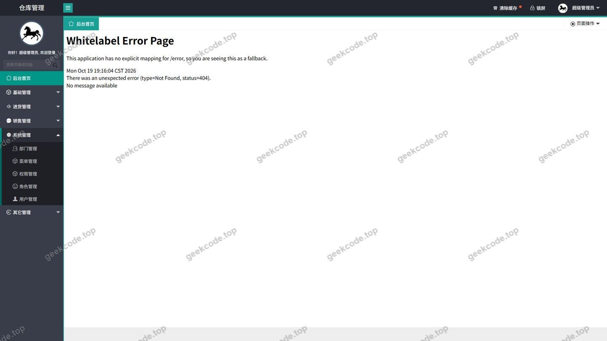</a>

<h4>页面-to客户管理员</h4>

<a href="https://geekcode.top/archives/java%E9%A1%B9%E7%9B%AE-ssm%E7%89%A9%E6%B5%81%E4%BB%93%E5%BA%93%E7%AE%A1%E7%90%86%E7%B3%BB%E7%BB%9F-%E6%AF%95%E4%B8%9A%E8%AE%BE%E8%AE%A1%E9%A1%B9%E7%9B%AE-30?utm_source=github" title="查看完整源码">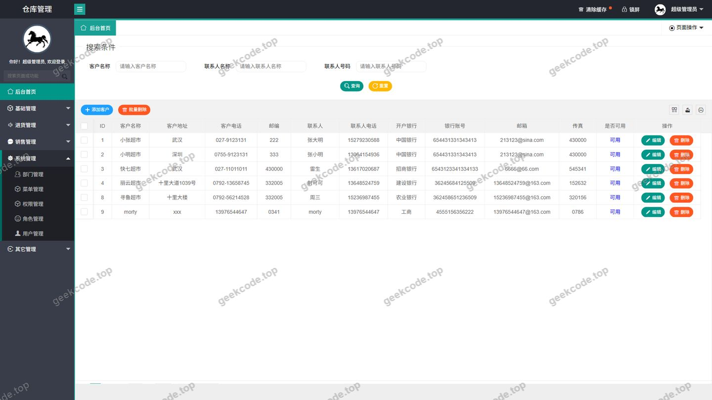</a>

<h4>页面-toGoods管理员</h4>

<a href="https://geekcode.top/archives/java%E9%A1%B9%E7%9B%AE-ssm%E7%89%A9%E6%B5%81%E4%BB%93%E5%BA%93%E7%AE%A1%E7%90%86%E7%B3%BB%E7%BB%9F-%E6%AF%95%E4%B8%9A%E8%AE%BE%E8%AE%A1%E9%A1%B9%E7%9B%AE-30?utm_source=github" title="查看完整源码">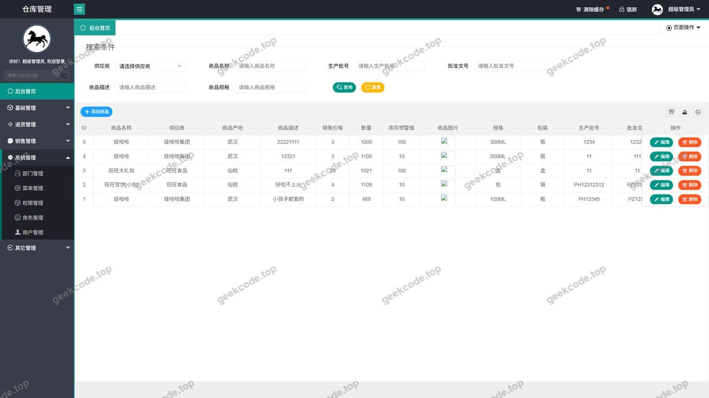</a>

<h4>页面-toInport管理员</h4>

<a href="https://geekcode.top/archives/java%E9%A1%B9%E7%9B%AE-ssm%E7%89%A9%E6%B5%81%E4%BB%93%E5%BA%93%E7%AE%A1%E7%90%86%E7%B3%BB%E7%BB%9F-%E6%AF%95%E4%B8%9A%E8%AE%BE%E8%AE%A1%E9%A1%B9%E7%9B%AE-30?utm_source=github" title="查看完整源码">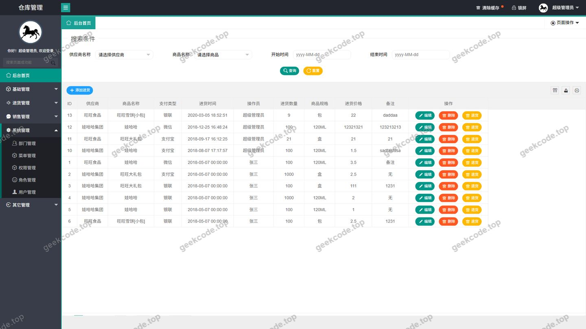</a>

<h4>页面-toOutport管理员</h4>

<a href="https://geekcode.top/archives/java%E9%A1%B9%E7%9B%AE-ssm%E7%89%A9%E6%B5%81%E4%BB%93%E5%BA%93%E7%AE%A1%E7%90%86%E7%B3%BB%E7%BB%9F-%E6%AF%95%E4%B8%9A%E8%AE%BE%E8%AE%A1%E9%A1%B9%E7%9B%AE-30?utm_source=github" title="查看完整源码">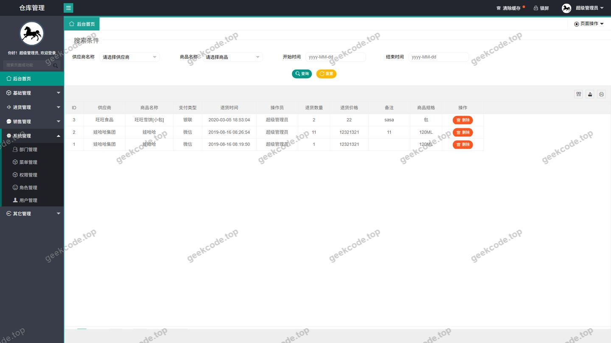</a>

<h4>页面-toProvider管理员</h4>

<h4>页面-toSalesback管理员</h4>

<a href="https://geekcode.top/archives/java%E9%A1%B9%E7%9B%AE-ssm%E7%89%A9%E6%B5%81%E4%BB%93%E5%BA%93%E7%AE%A1%E7%90%86%E7%B3%BB%E7%BB%9F-%E6%AF%95%E4%B8%9A%E8%AE%BE%E8%AE%A1%E9%A1%B9%E7%9B%AE-30?utm_source=github" title="查看完整源码">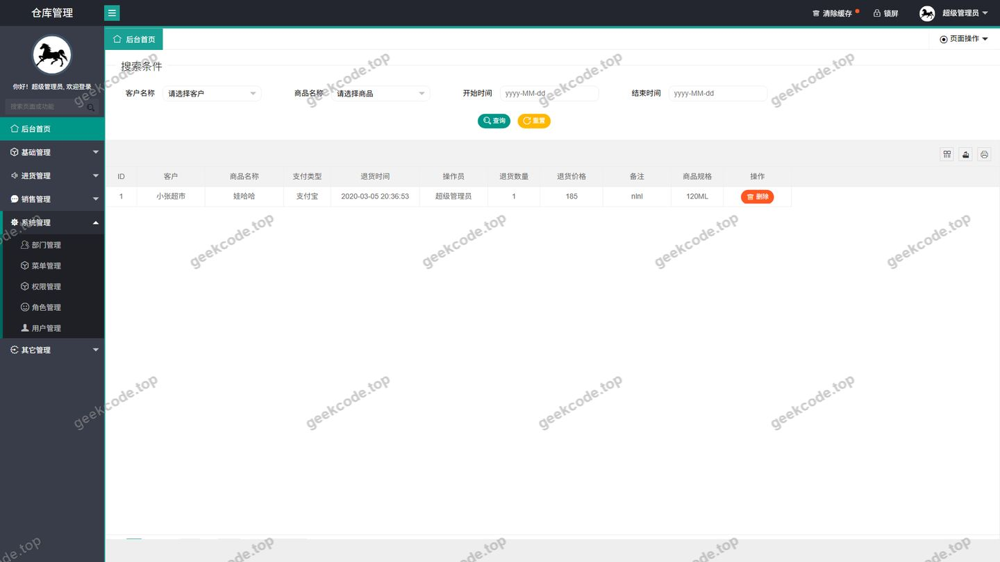</a>

<h4>页面-toSales管理员</h4>

<a href="https://geekcode.top/archives/java%E9%A1%B9%E7%9B%AE-ssm%E7%89%A9%E6%B5%81%E4%BB%93%E5%BA%93%E7%AE%A1%E7%90%86%E7%B3%BB%E7%BB%9F-%E6%AF%95%E4%B8%9A%E8%AE%BE%E8%AE%A1%E9%A1%B9%E7%9B%AE-30?utm_source=github" title="查看完整源码">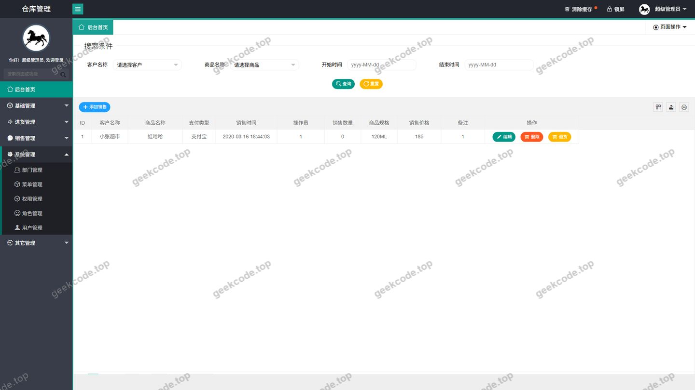</a>

<h4>登录页</h4>

<a href="https://geekcode.top/archives/java%E9%A1%B9%E7%9B%AE-ssm%E7%89%A9%E6%B5%81%E4%BB%93%E5%BA%93%E7%AE%A1%E7%90%86%E7%B3%BB%E7%BB%9F-%E6%AF%95%E4%B8%9A%E8%AE%BE%E8%AE%A1%E9%A1%B9%E7%9B%AE-30?utm_source=github" title="查看完整源码">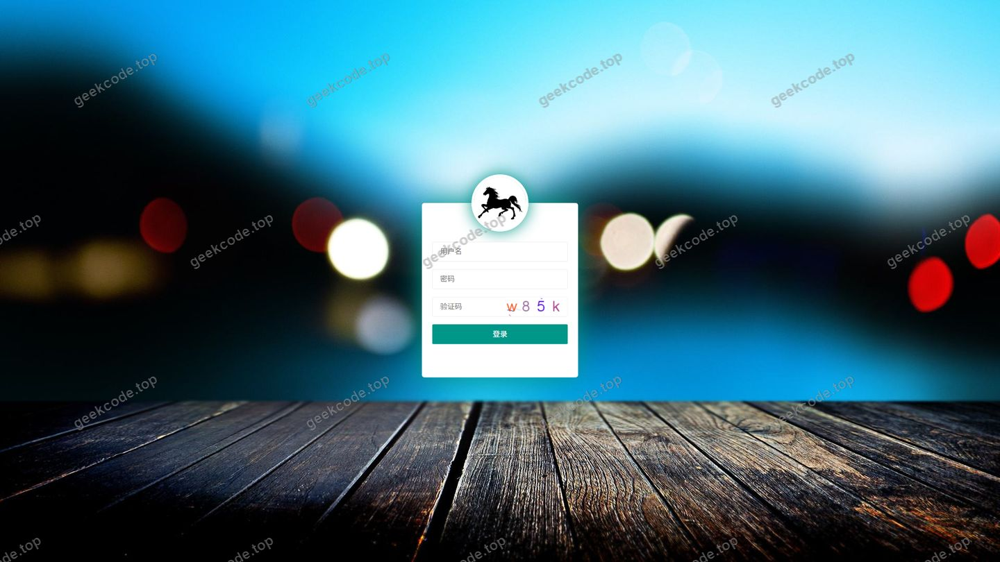</a>

<h4>页面-系统首页</h4>

<a href="https://geekcode.top/archives/java%E9%A1%B9%E7%9B%AE-ssm%E7%89%A9%E6%B5%81%E4%BB%93%E5%BA%93%E7%AE%A1%E7%90%86%E7%B3%BB%E7%BB%9F-%E6%AF%95%E4%B8%9A%E8%AE%BE%E8%AE%A1%E9%A1%B9%E7%9B%AE-30?utm_source=github" title="查看完整源码">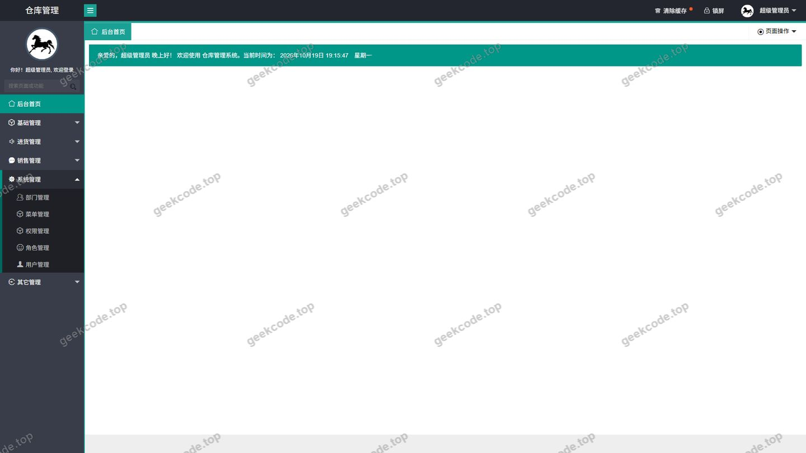</a>

<h4>页面-toChange修改密码</h4>

<a href="https://geekcode.top/archives/java%E9%A1%B9%E7%9B%AE-ssm%E7%89%A9%E6%B5%81%E4%BB%93%E5%BA%93%E7%AE%A1%E7%90%86%E7%B3%BB%E7%BB%9F-%E6%AF%95%E4%B8%9A%E8%AE%BE%E8%AE%A1%E9%A1%B9%E7%9B%AE-30?utm_source=github" title="查看完整源码">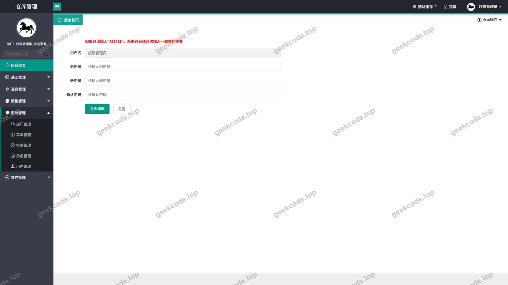</a>

<h4>页面-toDept管理员</h4>

<a href="https://geekcode.top/archives/java%E9%A1%B9%E7%9B%AE-ssm%E7%89%A9%E6%B5%81%E4%BB%93%E5%BA%93%E7%AE%A1%E7%90%86%E7%B3%BB%E7%BB%9F-%E6%AF%95%E4%B8%9A%E8%AE%BE%E8%AE%A1%E9%A1%B9%E7%9B%AE-30?utm_source=github" title="查看完整源码">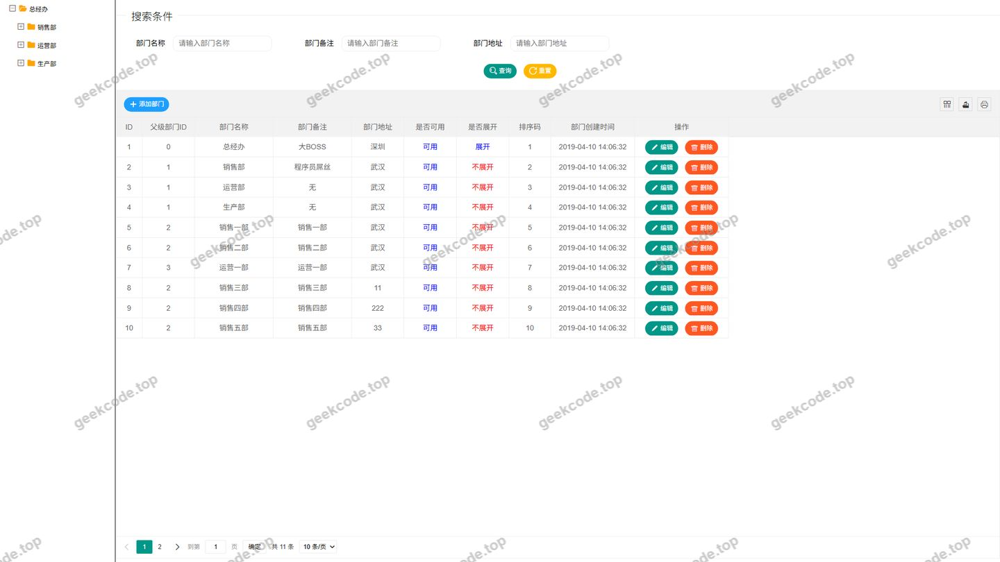</a>

<h4>页面-toDesk管理员</h4>

<h4>页面-to登录</h4>

<h4>页面-toLoginfo管理员</h4>

<a href="https://geekcode.top/archives/java%E9%A1%B9%E7%9B%AE-ssm%E7%89%A9%E6%B5%81%E4%BB%93%E5%BA%93%E7%AE%A1%E7%90%86%E7%B3%BB%E7%BB%9F-%E6%AF%95%E4%B8%9A%E8%AE%BE%E8%AE%A1%E9%A1%B9%E7%9B%AE-30?utm_source=github" title="查看完整源码">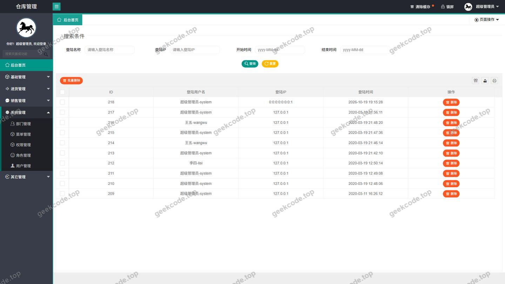</a>

<h4>页面-to公告信息管理员</h4>

<a href="https://geekcode.top/archives/java%E9%A1%B9%E7%9B%AE-ssm%E7%89%A9%E6%B5%81%E4%BB%93%E5%BA%93%E7%AE%A1%E7%90%86%E7%B3%BB%E7%BB%9F-%E6%AF%95%E4%B8%9A%E8%AE%BE%E8%AE%A1%E9%A1%B9%E7%9B%AE-30?utm_source=github" title="查看完整源码">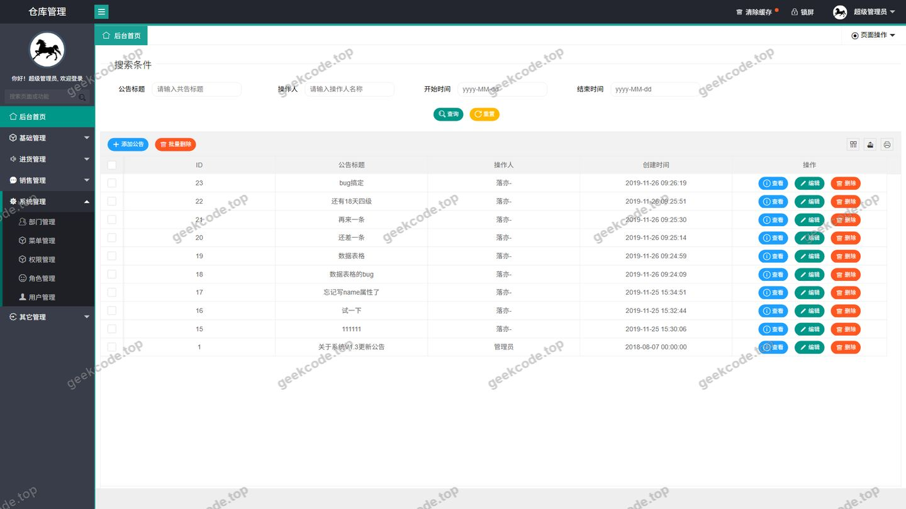</a>

<h4>页面-to用户信息</h4>

<a href="https://geekcode.top/archives/java%E9%A1%B9%E7%9B%AE-ssm%E7%89%A9%E6%B5%81%E4%BB%93%E5%BA%93%E7%AE%A1%E7%90%86%E7%B3%BB%E7%BB%9F-%E6%AF%95%E4%B8%9A%E8%AE%BE%E8%AE%A1%E9%A1%B9%E7%9B%AE-30?utm_source=github" title="查看完整源码">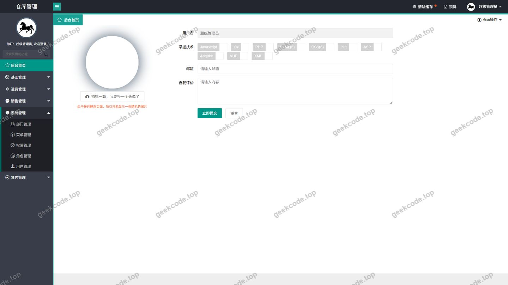</a>

---

## 获取完整源码

| 项目 | 说明 |
| --- | --- |
| 项目名 | java项目-ssm物流仓库管理系统-毕业设计项目-30 |
| 运行截图 | 本文 17 张（站点带水印原图，仓库 `images/` 目录） |
| 完整源码 | [https://geekcode.top/archives/java%E9%A1%B9%E7%9B%AE-ssm%E7%89%A9%E6%B5%81%E4%BB%93%E5%BA%93%E7%AE%A1%E7%90%86%E7%B3%BB%E7%BB%9F-%E6%AF%95%E4%B8%9A%E8%AE%BE%E8%AE%A1%E9%A1%B9%E7%9B%AE-30?utm_source=github](https://geekcode.top/archives/java%E9%A1%B9%E7%9B%AE-ssm%E7%89%A9%E6%B5%81%E4%BB%93%E5%BA%93%E7%AE%A1%E7%90%86%E7%B3%BB%E7%BB%9F-%E6%AF%95%E4%B8%9A%E8%AE%BE%E8%AE%A1%E9%A1%B9%E7%9B%AE-30?utm_source=github) |
| 咨询微信 | **ir9372**（备注：jingpin-yuanma） |
| 更多项目 | [极客代码 geekcode.top](https://geekcode.top/?utm_source=github) |

> 需要源码、部署、改配置、跑不起来等问题，加微信 ir9372 沟通，说明项目名即可。
